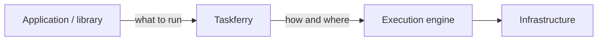

# ADR-0001: Taskferry is a portable execution layer

- Status: Accepted
- Date: 2026-07-26

## Context

Python applications need a stable way to describe work while deployment
configuration selects the execution engine. A shared runtime can route work,
check engine capabilities, and provide consistent execution identities without
coupling application code to a provider or web framework.

## Decision

Taskferry is a **portable execution layer**: one library that models units of work,
selects the appropriate execution kind, and routes them to existing engines
through adapters.

Concretely:

- `taskferry` is a regular package with a curated public API (`Taskferry`,
  `TaskSpec`, `JobSpec`, `Execution`, `ExecutionHandle`, `Router`, `Capability`).
- A single `Taskferry` runtime coordinates routing, backend construction,
  capability validation, handles, and hooks.
- Tasks are modelled framework-agnostically as `TaskSpec`; Django is one adapter
  among several.
- Events and Schedules are separately distributed concerns that compose with the
  execution layer.

## Alternatives considered

**A separate runtime per execution kind.** Rejected because applications would
need to coordinate backend selection and execution identity themselves.

**Make Taskferry a Django library.** Rejected because Python libraries, CLI
pipelines, and other frameworks also need to submit and observe work.

**Build one universal abstraction over deferred work covering tasks and jobs.**
Rejected for the reasons in [ADR-0003](0003-task-and-job.md).

## Consequences

- `from taskferry import Taskferry, TaskSpec, JobSpec` is the public entry point.
- Any Python process can submit work; Django remains optional.
- Backend selection is configuration-driven, so changing engines is a deployment
  decision.
- The core stays independent of provider and framework dependencies.
