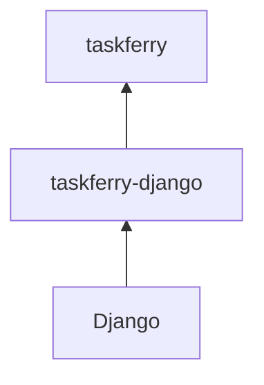

# ADR-0006: Frameworks are adapters, and they point inward

- Status: Accepted
- Date: 2026-07-26

## Context

Applications use Taskferry from Python with or without a web framework. Framework
integrations belong at the boundary, where they can translate framework APIs to
the portable runtime without adding framework dependencies to the core.

## Decision

`taskferry` never imports a web framework. Framework integration lives in adapter
distributions that depend on Taskferry, never the reverse.

`taskferry-django` supplies:

- `TaskferryBackend`, a real `django.tasks` backend that translates to `TaskSpec`;
- `config_from_settings()`, the only place in the project that reads
  `django.conf.settings`;
- `submit_on_commit()`, built on `transaction.on_commit`;
- system checks and `manage.py taskferry`.

Taskferry does **not** add a parallel task API for Django. Django 6 already has
one; competing with it would give applications two ways to do the same thing.

### The dispatcher

`@task` replaces a function with a `django.tasks.base.Task` object, which is not
callable. Rather than teach `taskferry` what a Django Task is, `taskferry-django`
routes every task through one entry point (`taskferry_django.execute:run_task`)
that knows how to run one. The Django task path travels as data.

This mirrors what `taskferry-procrastinate` does, has the useful side effect that a
worker's import allowlist needs exactly one module, and keeps Django's own
`Task.call()` semantics intact.

## Alternatives considered

**Let `taskferry` special-case Django Task objects when resolving a function.**
One `isinstance` check would make the core import Django and couple function
resolution to a framework. Rejected.

**Ship a `@taskferry.task` decorator for Django users.** Rejected — Django already
provides a task API, and a second one would duplicate its role.

**Have `taskferry` read a config file itself, so Django needs no adapter.** Then
Taskferry owns a file format and a discovery order, and Django users configure
their app in two places. Rejected in favour of
[ADR-0007](0007-configuration.md).

## Consequences

- `pytest packages/taskferry` passes in an environment with no Django installed,
  and CI runs exactly that as a separate job.
- The same `TASKFERRY` dict can be lifted verbatim into a FastAPI service or a CLI.
- FastAPI, Flask and Starlette need no adapter at all: they call the runtime
  directly, and `taskferry-cloudtasks`'s receiver takes bytes rather than a
  framework request object.
- `spec.task` is the same string for every Django task, so `spec.name` and a
  `django_task` label carry the real identity. A documented trade-off.
