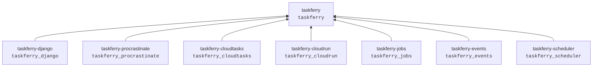

# ADR-0013: One distribution per top-level module

- Status: Accepted
- Date: 2026-07-26

## Context

Taskferry has a public core API and independently versioned framework and provider
integrations. Each distribution needs a clear import owner, installable on its own
and testable without unrelated providers.

## Decision

Every distribution owns its own top-level module.

- `taskferry` declares **zero dependencies**, asserted by a test that reads the
  metadata as well as the source.
- Provider SDKs live in extras (`taskferry-jobs[aws]`), never in required
  dependencies, so installing an adapter never forces an SDK you do not use.
- Adapters advertise their backends through the `taskferry.backends` entry-point
  group, so configuration can name one without anything importing it eagerly.

## Alternatives considered

**Place the public API in a nested `taskferry.api` module.** Rejected because the
curated API belongs at the package root and should be available from
`from taskferry import Taskferry`.

**One distribution with every adapter behind extras.** Simplest to release, and it
means `pip install taskferry` has to at least *know about* every provider, the
release cadence is shared, and a bug in the Azure adapter blocks a core release.
Rejected — independent versioning is the point.

**A single `taskferry` distribution plus one `taskferry-adapters` bundle.** Halfway
between the two, with the disadvantages of both. Rejected.

## Consequences

- `pip install taskferry` installs nothing else. This is the headline property, and
  it is tested three ways: source scan, runtime `sys.modules` check, and metadata.
- Each adapter uses its own top-level import package, such as `taskferry_django`
  or `taskferry_cloudtasks`.
- Each package remains independently buildable and extractable to its own
  repository, which [ADR-0014](0014-monorepo-to-multirepo.md) still describes.
