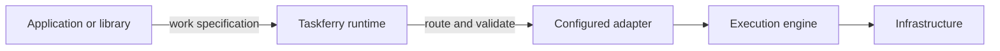
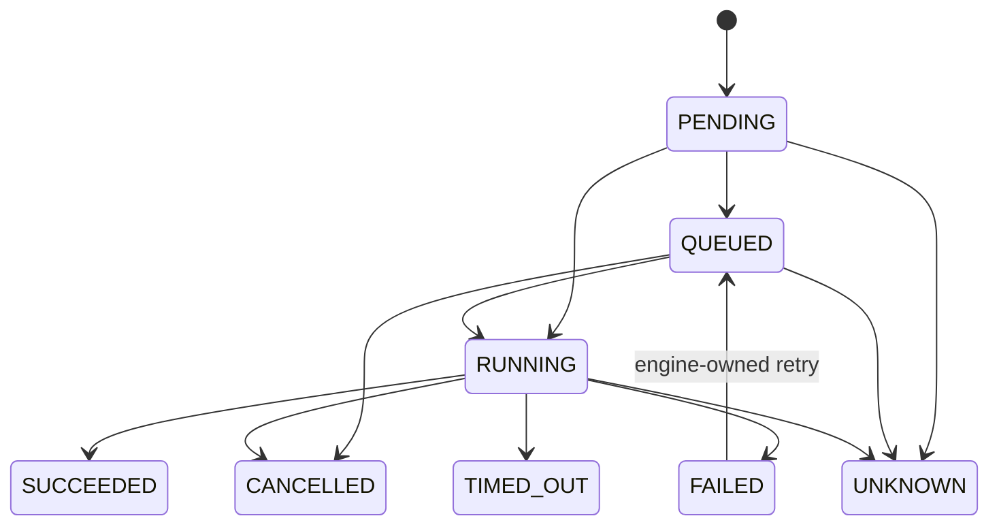
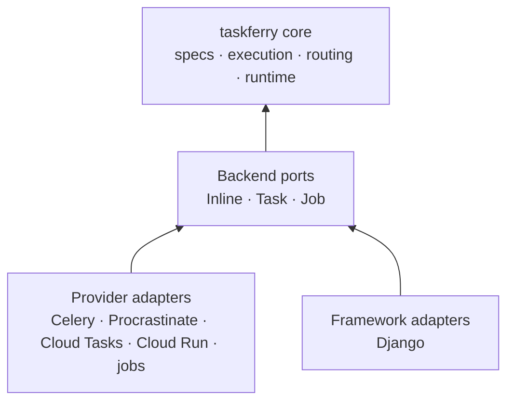

# Concepts and design

Taskferry is a portable execution layer for Python applications. It gives
applications one model for describing work and routes each execution to a
configured backend. The backend uses an execution engine such as Django Tasks,
Celery, Procrastinate, Cloud Tasks, Cloud Run Jobs, Kubernetes, or a local
process.

Applications describe **what should run**. Configuration describes **where and
how it runs**.



## Work types

Taskferry models three execution kinds. They have distinct specifications,
backend contracts, and capability requirements.

| Kind | Purpose | Execution location | Typical payload |
| --- | --- | --- | --- |
| **Inline** | Run a callable immediately | Calling process | Callable and Python arguments |
| **Task** | Dispatch a named operation | Worker or push endpoint | Function reference and JSON arguments |
| **Job** | Run an isolated workload to completion | Process, container, or batch service | Image, command, and resource requirements |

A Job describes an isolated workload, including its image and resource envelope.
A Task describes a named operation dispatched to a task engine. Each kind has
its own portable specification and backend port.

## Runtime and routing

`Taskferry` is the application-facing runtime. It owns configuration, backend
construction, routing, capability checks, and execution handles. Applications
submit through `runtime.inline`, `runtime.tasks`, or `runtime.jobs`.

Routes match attributes such as execution kind, queue, profile, task name, and
labels. A route selects a backend factory and supplies its configuration. This
keeps provider selection in deployment configuration while application code uses
the same Taskferry API.

```python
runtime.tasks.submit(
    "myapp.tasks:extract_metadata",
    dataset_id,
    queue="metadata",
)
```

The configured route can map this call to a local backend, a Django Tasks
integration, Celery, Procrastinate, Cloud Tasks, or another adapter that
implements the task backend contract.

## Execution identity and state

Every submitted operation has a portable `Execution` identity and an
`ExecutionHandle`. Adapters map engine identifiers and observable states onto
Taskferry's shared execution model.



`UNKNOWN` represents an execution whose state the selected engine cannot report.
Adapters describe their capabilities so callers can distinguish unsupported
state lookup from a reported execution state.

## Capabilities

Capabilities define which operations and execution requirements a backend can
honor. A backend advertises an immutable `CapabilitySet`; Taskferry checks
required capabilities before submission. Unsupported operations raise
`UnsupportedCapability` instead of silently succeeding or pretending to emulate
provider behavior.

Capabilities can vary by provider and configuration. Applications can inspect a
handle or backend's capabilities when behavior depends on support for cancellation,
results, retries, scheduling, logs, or resource requirements.

## Adapter boundaries

Taskferry follows a ports-and-adapters design. The core defines the portable
specifications, runtime, contracts, and capability vocabulary. An adapter
implements a core port and translates between Taskferry concepts and an engine's
API.



Dependencies point inward: the core does not import frameworks, provider SDKs, or
infrastructure clients. Adapters are separate distributions, and integrations
load their SDK clients lazily. A Django integration may expose Django's task API
while routing execution through Taskferry; provider adapters can also be used
without Django.

The core distribution has no runtime dependencies. Provider SDKs and framework
packages are installed only when an application chooses an adapter that needs
them. Adapter packages expose backend factories through the
`taskferry.backends` entry-point group.

The distributions follow the same boundaries:

| Distribution group | Examples | Role |
| --- | --- | --- |
| Core | `taskferry` (`taskferry`) | Runtime, specifications, ports, routing, and local backends |
| Framework integration | `taskferry-django` (`taskferry_django`) | Connects Django Tasks and Django settings to the runtime |
| Task backends | `taskferry-celery`, `taskferry-procrastinate`, `taskferry-cloudtasks`, `taskferry-dramatiq`, `taskferry-sqs`, `taskferry-servicebus` | Dispatch Taskferry tasks through task engines |
| Job backends | `taskferry-cloudrun`, `taskferry-jobs` | Run isolated jobs through cloud and batch engines |
| Adjacent packages | `taskferry-events`, `taskferry-scheduler`, `taskferry-otel` | Events, schedules, and OpenTelemetry integration |

## Portable function calls and payloads

Task payloads use JSON-compatible data and a named function reference such as
`myapp.tasks:send_email`. A worker resolves that reference through an allowlisted
`FunctionRegistry`. The portable payload does not contain a live Python callable
or a pickled object.

Inline execution can accept a callable because it remains in the calling process.
Task and job backends serialize only the data required by their execution
contract. Provider-specific payloads and credentials remain inside the adapter.

## Retry, timeout, and delivery

`RetryPolicy` and `TimeoutPolicy` express portable intent. A policy identifies
which layer owns retries, so application, Taskferry, and engine retries do not
multiply unintentionally. Adapters translate supported policy fields to native
engine options and report unsupported requirements through capabilities.

Distributed delivery is generally at least once. A worker can receive the same
message again after a crash or acknowledgement loss. Taskferry does not promise
exactly-once execution; applications should make side effects idempotent when
duplicate delivery matters. An adapter advertises deduplication only when its
engine provides the relevant guarantee.

## Scope

Taskferry coordinates execution through existing engines. It does not provide a
durable queue, broker, worker daemon, scheduler daemon, distributed lock service,
orchestration engine, or exactly-once processing system. The built-in inline,
thread, process, and subprocess backends support local development and workloads
that do not require durable distributed execution.

Events and schedules are separate distributions in the Taskferry project. They
compose with execution backends but are not execution kinds in the core runtime.

## Architectural guarantees

The repository's architecture checks enforce that:

- the core imports no framework or provider SDK;
- importing the core does not load heavy optional packages;
- the `taskferry` distribution declares no runtime dependencies;
- adapter distributions do not depend on one another or add modules to the core
  package;
- unsupported capabilities are surfaced explicitly.

The checks live in
[`packages/taskferry/tests/test_architecture.py`](https://github.com/xiidigital/taskferry/blob/main/packages/taskferry/tests/test_architecture.py)
and run in CI.
