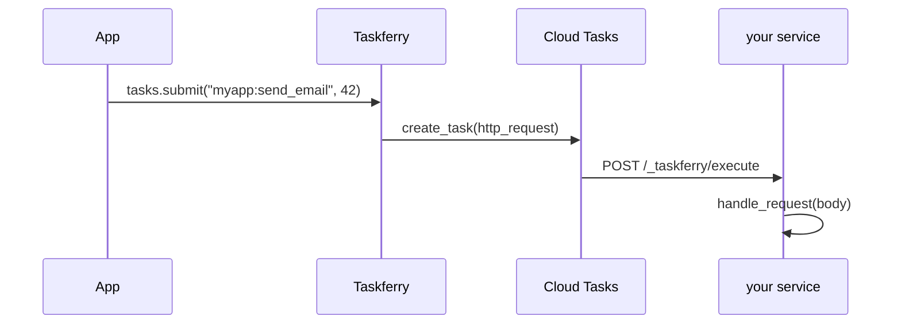

# taskferry-cloudtasks

Run [Taskferry](https://github.com/xiidigital/taskferry) tasks on **Google Cloud
Tasks** — push-based, serverless, no worker process.



Cloud Tasks is architecturally the opposite of Procrastinate — nothing polls, no
worker exists, Google pushes an HTTP request at your service. The application
code does not change:

```python
runtime.tasks.submit("myapp.tasks:send_email", 42, queue="email")
```

## Install

```bash
pip install 'taskferry-cloudtasks[gcp]'
```

## Configure

```python
runtime = Taskferry.from_mapping(
    {
        "backends": {
            "push": {
                "factory": "cloudtasks",
                "project": "my-project",
                "location": "europe-west1",
                "url": "https://my-service.run.app/_taskferry/execute",
                "service_account_email": "runner@my-project.iam.gserviceaccount.com",
            }
        },
        "defaults": {"task": "push"},
    }
)
```

## Receive

`handle_request` takes bytes, so it works with any framework:

```python
# Django
from taskferry import FunctionRegistry
from taskferry_cloudtasks import handle_request

REGISTRY = FunctionRegistry(allowed_modules=["myapp"])


def taskferry_execute(request):
    handle_request(request.body, dict(request.headers), registry=REGISTRY)
    return HttpResponse(status=204)
```

```python
# FastAPI
@app.post("/_taskferry/execute")
async def execute(request: Request):
    handle_request(await request.body(), dict(request.headers), registry=REGISTRY)
    return Response(status_code=204)
```

**Authenticate the endpoint.** Verify the OIDC token Cloud Tasks sends, or put
the service behind IAM. Taskferry never sees your framework's request object —
that is what makes it portable, and it is why this part is yours.

**Be idempotent.** Cloud Tasks delivery is at-least-once.

## Capabilities

| Capability | Supported | Why |
| ---------- | :-------: | --- |
| `SUBMIT` · `DELAY` · `RETRY` | yes | `create_task`, `schedule_time`, per-task retry config |
| `DEDUPLICATION` | yes | task names are unique per queue for a bounded window |
| `EXECUTION_CONTEXT` | yes | The push request includes the task identity and retry count |
| `ATTEMPT_COUNT` | yes, while retained | `get_task()` reports `dispatch_count` for an existing task |
| `DELETE_PENDING` | yes | `delete_task()` removes a scheduled or dispatched delivery |
| `STATE` · `RESULT` · `CANCEL` | **no** | No durable outcome store, return value, or guaranteed interruption |

A handle refuses `status()` here instead of returning a plausible `UNKNOWN`
forever. `handle.attempt_count()` is a separate, temporary query: Cloud Tasks
returns `dispatch_count` only while the task exists. Successfully completed or
exhausted tasks are deleted, so this is neither durable state nor a result.
`handle.delete_pending()` calls Cloud Tasks `delete_task`; it removes a scheduled
or dispatched task, but it cannot promise to stop a handler that has already
started. This is deliberately distinct from `cancel()`.

The push request's `X-CloudTasks-TaskRetryCount` header is passed through as the
current Django `TaskContext.attempt` (`retry count + 1`). Cloud Tasks does not
provide a worker id or the original enqueue timestamp to this adapter. Record
durable progress, return values, or retry history in application-owned storage.

### Per-task retries

Each submitted task carries Cloud Tasks' task-level `RetryConfig`; this overrides
the queue's retry configuration. `max_attempts` includes the first delivery. If
the Taskferry policy has no retries, Taskferry sets `max_attempts=1` so a queue's
default retry policy cannot add attempts. The task-level field requires
`google-cloud-tasks>=2.26` (`pip install 'taskferry-cloudtasks[gcp]'`).

Cloud Tasks supports fixed, linear, and capped exponential backoff, but its
durations have whole-second precision. Taskferry rejects subsecond delays instead
of rounding them, as well as immediate retries, more than 100 attempts, or
backoff over one hour. The portable policy's jitter hint has no Cloud Tasks equivalent
and is ignored. The portable policy has no maximum elapsed retry duration, so
Taskferry sets `max_retry_duration="0s"` and relies on the configured attempt
limit plus Cloud Tasks' task retention behavior. For exception filters, the HTTP
receiver acknowledges a non-matching exception with 2xx to stop retries; the
failure is logged, but Cloud Tasks does not retain a durable Taskferry failure
record. A matching exception remains a failed delivery so Cloud Tasks can retry
it until `max_attempts` is reached. Make handlers idempotent because delivery is
at least once.

## License

Apache-2.0.
