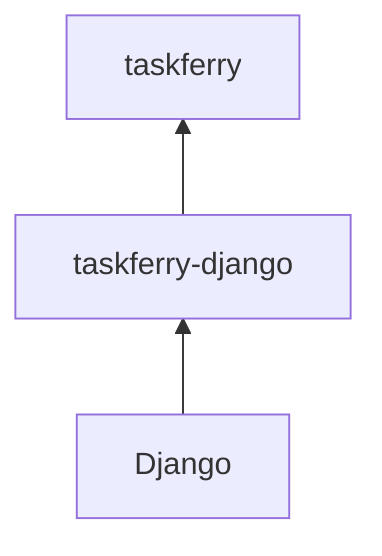

# taskferry-django

Django integration for [Taskferry](https://github.com/xiidigital/taskferry).



This package supports **Django 6.0+ native `django.tasks`**. Django introduced
that API in 6.0; this package imports it directly and does not integrate the
third-party `django-tasks` backport. Taskferry does **not** invent a parallel API. This
package supplies a backend for the standard `TASKS` setting, so your `@task` code
never changes while the engine behind it becomes a configuration choice.

```bash
pip install taskferry-django taskferry-procrastinate
```

## Your code never changes

```python
# myapp/tasks.py
from django.tasks import task


@task
def resize_image(image_id: int) -> None: ...
```

```python
# anywhere
resize_image.enqueue(42)
```

## Settings

```python
TASKS = {"default": {"BACKEND": "taskferry_django.TaskferryBackend"}}

TASKFERRY = {
    "backends": {
        "celery": {"factory": "celery", "app": "myproject.celery:app"},
        "gcp": {
            "factory": "cloudtasks",
            "project": "my-project",
            "location": "us-central1",
            "url": "https://example.run.app/_taskferry/execute",
        },
    },
    "routes": [
        {"kind": "task", "queue": "local-workers", "backend": "celery"},
        {"kind": "task", "queue": "serverless", "backend": "gcp"},
    ],
    "defaults": {"task": "celery"},
}
```

For Celery, configure broker/result storage on `myproject.celery:app` itself;
the backend name in Taskferry chooses the Celery execution adapter, while Celery
chooses its broker and optional result store. Change the queue routes or default
to move Django tasks between Celery and Cloud Tasks without changing task code.

With no `TASKFERRY` setting at all, everything runs locally — a fresh project works
immediately and is obviously not production.

### Choosing execution and storage

Choose an engine through `TASKFERRY.backends` and route queues with the usual
`routes`/`defaults` configuration. Django's native Tasks API is the enqueue
interface; it does not include a production queue or durable task store. Provider
integrations are separate optional distributions:

```bash
pip install taskferry-django taskferry-celery[celery]
# If Redis is your chosen Celery broker and/or result backend:
pip install 'taskferry-celery[redis]'
# If RabbitMQ is your chosen Celery broker:
pip install 'taskferry-celery[rabbitmq]'
# For GCP push delivery:
pip install taskferry-django 'taskferry-cloudtasks[gcp]'
```

Celery's broker and result backend are configured on the Celery app, independently
of Taskferry routing. Redis is optional; Celery can use other supported brokers
and result stores, or run without result storage. The `rabbitmq` extra is an
installation alias; Celery includes its AMQP transport. RabbitMQ can also use
Celery's transient `rpc://` result backend, or pair with a separate database
result backend. The Taskferry Celery adapter
advertises result retrieval only when `app.conf.result_backend` is configured.
Cloud Tasks is a push queue: it cannot report execution state or persist return
values, so persist progress and results in application-owned storage if required.

Taskferry serializes task names and arguments as JSON; pass identifiers or other
JSON-safe values, never ORM instances or pickled objects. Cloud Tasks provides
time-bounded task-name deduplication when an idempotency key is supplied; Celery
does not, so keyed submissions are rejected there. Cloud Tasks and Celery retry
through their native engines according to the Taskferry retry policy. Delivery
can be duplicated: make task handlers idempotent. Celery revoke is best effort
and does not interrupt a running handler; Cloud Tasks does not expose cancellation.
Taskferry has no portable progress reporting contract yet. Celery's persisted
state can show queued/started/terminal state when configured, but richer progress
belongs in application storage.

## What else you get

**Enqueue after commit.** The classic race — a worker reaching a row before the
transaction that created it commits — with the classic fix:

```python
from django.db import transaction
from taskferry_django import task_on_commit


def create_order(request):
    with transaction.atomic():
        order = Order.objects.create(...)
        task_on_commit("myapp.tasks:process_order", order.id)
```

**System checks.** `manage.py check` builds every configured backend, because
"the adapter is installed" and "the adapter works with these options" are
different questions:

```text
taskferry.E002  the Taskferry backend 'heavy' cannot be built: CloudRunJobBackend
               needs both 'project' and 'location'
taskferry.W003  DEBUG is False but these Taskferry backends run in this process and
               lose pending work on restart: fast
```

**The CLI, with settings loaded.**

```bash
python manage.py taskferry doctor
python manage.py taskferry capabilities pg
```

**Jobs and inline execution**, through the same runtime:

```python
from taskferry_django import get_runtime

get_runtime().jobs.submit("build-cog", image="gdal:latest", profile="heavy")
```

## The dependency direction

`taskferry` never imports Django. The test suite for the core runs — and CI runs
it — in an environment where Django is not installed. The same `TASKFERRY` dict
works verbatim in a FastAPI service, a CLI or a library.

## License

Apache-2.0.
